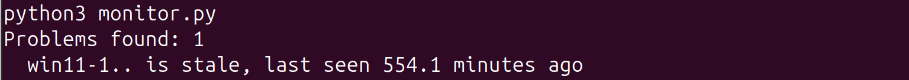
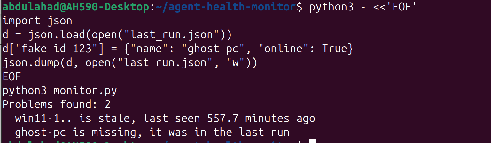

# Agent Health Monitor

Python script that checks the sensors (agents) in LimaCharlie's EDR and reports the ones that have stopped checking in, been cut off from the network, or disappeared completely.

An EDR sensor is a small program installed on a computer that watches for threats. If it stops working, that computer is no longer protected, and nobody notices unless they check. Checking by hand takes time and gets skipped. This script does the check automatically and prints a list of problems.

## How it works

```
┌───────────────────────────┐
│  LimaCharlie (free tier)  │
│  2 Windows 11 sensors     │
└─────────────┬─────────────┘
              │ REST API: API key -> temporary pass (JWT) -> sensor list
┌─────────────▼─────────────┐       ┌──────────────────────────┐
│  monitor.py               │◄─────►│  last_run.json           │
│  skips ext- helpers       │       │  (what the last run saw) │
│  checks every sensor      │       └──────────────────────────┘
└─────────────┬─────────────┘
              │
┌─────────────▼─────────────┐
│  Problems report          │
│  stale / isolated /       │
│  missing                  │
└───────────────────────────┘
```

## What this lab covers

- [x] Set up a LimaCharlie account (free EDR) and install sensors on two Windows 11 VMs
- [x] Create an API key with only the permissions the script needs (`sensor.list` and `sensor.get`)
- [x] Log in to the API from Python by trading the API key for a temporary pass (JWT)
- [x] Pull the list of sensors and skip LimaCharlie's own `ext-` helper sensors
- [x] Flag stale sensors (offline and quiet for more than 15 minutes)
- [x] Flag isolated sensors (cut off from the network)
- [x] Flag missing sensors (they were in the last run but are gone now)
- [ ] Coverage percentage and how it changes between runs
- [ ] Open a GitHub Issue automatically for each problem
- [ ] Run on a daily schedule with cron

## Tech stack

| Component | Purpose |
|---|---|
| LimaCharlie (free tier) | The EDR. Keeps the list of sensors and when each one last checked in. Free tier allows 2 sensors |
| LimaCharlie REST API | How the script reads the sensor list |
| Python (`requests`, `json`, `datetime`) | The script itself |
| `last_run.json` | A small file where the script saves each run so the next run can compare |

## Lab setup

- Host: Ubuntu desktop, runs the script
- Targets: 2 Windows 11 VMs, each with a LimaCharlie sensor installed
- API key permissions: `sensor.list` and `sensor.get` only (the script only reads, so it is only allowed to read)
- The Org ID and API key are read from environment variables, so they are never written in the code

## How it decides what is a problem

```
if sensor name starts with "ext-":
    skip it (LimaCharlie's own helper, not one of my computers)

if the sensor is offline AND last check-in was more than 15 minutes ago:
    STALE

if the sensor is isolated:
    ISOLATED

if the sensor was in last_run.json but is not in this run:
    MISSING
```

Stale needs both signals (offline and quiet for 15 minutes) on purpose. During testing, one VM showed as online even though its last check-in was over 20 minutes old, so using the last check-in time alone would have flagged a healthy sensor.

LimaCharlie writes its times in UTC, so the script compares everything in UTC.

## Setup

1. Make a LimaCharlie API key with only `sensor.list` and `sensor.get`
2. Install the dependency:

   ```
   pip install -r requirements.txt
   ```

3. Set your Org ID and API key as environment variables (never put them in the code):

   ```
   export LC_OID="your-org-id"
   export LC_API_KEY="your-api-key"
   ```

4. Run:

   ```
   python3 monitor.py
   ```

The first run saves a baseline in `last_run.json`. Each run after that compares against the one before.

## Result

LimaCharlie showed 5 sensors in total. 3 were `ext-` helpers that the script skipped, so 2 were mine. VM1 was shut down on purpose and VM2 stayed online. The script only prints problems, so the healthy sensor does not appear in the output.

| Sensor | Problem | Detail |
|---|---|---|
| win11-1 | Stale | Offline, last seen about 556 minutes ago |



### Missing sensor test

To test the missing check, I added a fake sensor called `ghost-pc` to `last_run.json` on purpose, so the script thought it had been there last time. This is a simulation, not a real incident.

| Sensor | Problem | Detail |
|---|---|---|
| ghost-pc | Missing | Was in the last run, gone now (simulated) |



## Key finding

A sensor can be dead and still show up on the list, and a sensor can vanish from the list completely. These are two different problems, so the script checks for both. Checking only "is it online" would miss a sensor that disappeared, and checking only "is it on the list" would miss one that stopped working.

## Repo structure

```
agent-health-monitor/
├── README.md
├── monitor.py            # the script
├── requirements.txt      # Python toolbox it needs (requests)
├── .gitignore            # keeps last_run.json out of GitHub
└── screenshots/
    ├── stale.png
    └── missing-test.png
```

`last_run.json` is created when the script runs. It is not uploaded to GitHub.

## What I would add next

- Coverage percentage and the change between runs, so a slow drop in protected computers is easy to see
- Open a GitHub Issue for each problem, so someone is told without having to read the output
- Run it every day with cron, since right now it only runs when I start it
- Scale up: more sensors, and a check that a sensor's status has been bad for several runs in a row, not just one
